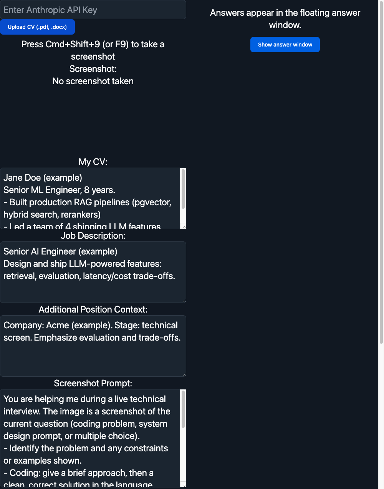
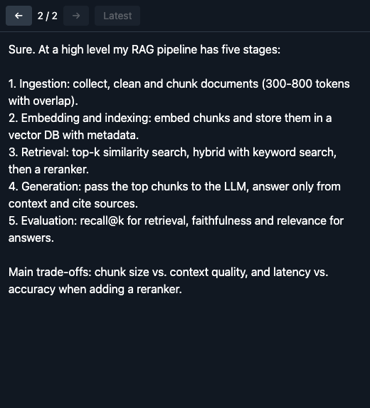

# ainterview

An experimental desktop assistant for **interview practice**: it listens to the interviewer (system audio, e.g. Zoom) and to you (mic), transcribes locally with whisper.cpp, and asks Claude for a suggested answer. It can also answer from a screenshot of a question.

> [!WARNING]
> **Disclaimer: experimental use only.** This project is a proof of concept for learning and experimentation. It is **not intended for use in real job interviews**. Using AI assistance where it is prohibited can violate an employer's or interviewer's rules, be unfair to other candidates, and may cost you an opportunity. You are solely responsible for how you use it. Practice and mock interviews are the intended use.

| Main window (config) | Floating answer window |
|---|---|
|  |  |

<sub>Demo data (fictional CV and job description).</sub>

## Features

- **Floating answer window**: always on top, with a loader while a call is in flight. Step through earlier answers with the arrow buttons, ← / →, or the global **Cmd/Ctrl+Shift+←/→**. A new answer jumps back to the latest.
- **Context-aware answers**: paste or upload your CV (`.pdf`, `.docx`, `.txt`) and add the job description and extra position context. All of it is added to every prompt, and everything on the main page persists between runs.
- **Local transcription**: whisper.cpp and the `base.en` model are bundled in the release builds, so audio never leaves your machine. Transcripts, screenshots and your context are sent to Anthropic's API with your own key.
- **Hidden from screen sharing** (`setContentProtection`). Newer macOS versions may ignore this for ScreenCaptureKit-based sharing, so test it with your video app before relying on it.
- **Hands-free shortcuts**, including support for a cheap 2-key USB pad.

## Install

Download the latest build from the [releases](../../releases): `.dmg` for macOS (Apple Silicon) or `-setup.exe` for Windows (x64). The Windows build is untested.

Builds are unsigned: on macOS right-click → Open (or `xattr -cr ainterview.app`); on Windows choose "More info → Run anyway".

## Usage

1. Enter your Anthropic API key.
2. Add your CV, job description and context.
3. Grant microphone and screen/system-audio recording permissions when asked.
4. Start capture, let the interviewer speak, stop capture. The transcription appears in the main window and the answer in the floating window.

### Shortcuts

| Action | Shortcut |
|---|---|
| Screenshot | Cmd/Ctrl+Shift+9 (or F9) |
| Start audio capture | Cmd/Ctrl+Shift+7 (or F7) |
| Stop audio capture | Cmd/Ctrl+Shift+8 (or F8) |
| Previous / next answer | Cmd/Ctrl+Shift+← / → |

To drive these from a 2-key USB pad (key 1 = start, key 2 = stop, both = screenshot), see [External keyboard](docs/external-keyboard.md).

## Docs

- [Architecture and internals](docs/architecture.md)
- [External 2-key pad / keybindings](docs/external-keyboard.md)
- [AGENTS.md](AGENTS.md): guidance for AI agents configuring or troubleshooting the app

## Development

```
npm install
npm run dev
```

In dev the app uses a local whisper install: `whisper-cli` at `~/.local/bin/whisper-cli` and the model at `~/.cache/whisper/ggml-base.en.bin` (override with `WHISPER_BIN` / `WHISPER_MODEL`).

### Build

Packaged builds expect whisper files in `resources/whisper/` (git-ignored because of size):

```
resources/whisper/ggml-base.en.bin   # ggml model
resources/whisper/mac/whisper-cli    # macOS arm64 binary
resources/whisper/win/               # whisper-cli.exe + DLLs (whisper.cpp release "whisper-bin-x64.zip")
```

```
npx nextron build --mac --arm64
npx nextron build --win --x64
```

Each build wipes `dist/`, so copy the first artifact out before running the second.

## Built with

[Electron](https://www.electronjs.org/) + [Next.js](https://nextjs.org/) via [nextron](https://github.com/saltyshiomix/nextron), [whisper.cpp](https://github.com/ggml-org/whisper.cpp), and the [Anthropic SDK](https://github.com/anthropics/anthropic-sdk-typescript).
